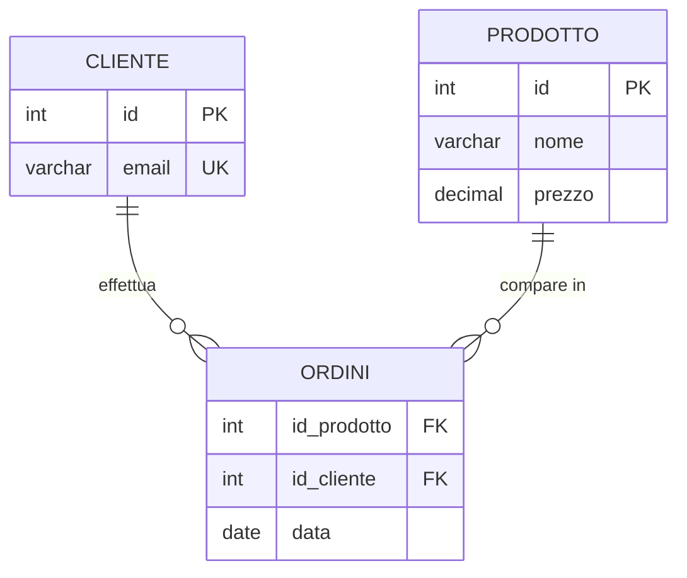

# 🛒 Casafiore Shop — Analisi dei dati di vendita con SQL

Analisi dei dati storici di vendita di un e-commerce fittizio (**Casafiore Shop**) con **SQL**: dal database e le tabelle fino a clienti, prodotti, andamento settimanale e ordini. Un unico file SQL con tutte le query, organizzate per fase e commentate in modo che siano comprensibili anche a chi non scrive SQL tutti i giorni.

Progetto realizzato come lavoro di portfolio nell'ambito di un corso di Data Analysis / SQL.

## Il problema

Il team Marketing & CRM deve pianificare le campagne dei prossimi mesi e vuole basare le scelte su numeri solidi, non su sensazioni. Serve un'analisi dei dati storici di vendita per rispondere a quattro domande:

| Domanda | A cosa serve |
|---------|--------------|
| Chi sono i clienti che spendono di più? | programma fedeltà |
| Quali prodotti fatturano di più (best-seller)? | scelta dei prodotti da promuovere |
| In quali giorni della settimana si vende di più? | quando programmare newsletter e promozioni |
| Quanti prodotti contiene in media un ordine? | comprensione del comportamento d'acquisto |

## I dati

Tre tabelle, create e popolate dallo script:



- **prodotto** — 10 prodotti (ID, nome, prezzo)
- **cliente** — 5 clienti (ID, email)
- **ordini** — 20 transazioni dal 1° al 20 gennaio 2025: ogni riga associa un prodotto a un cliente in una data

## Le fasi dell'analisi

| Fase | Contenuto |
|------|-----------|
| 1 | Creazione del database |
| 2 | Creazione delle tabelle (con chiavi primarie, esterne e vincoli) |
| 3 | Inserimento dei dati e controllo con `SELECT` |
| 4 | **Dataset integrato**: `INNER JOIN` tra ordini, clienti e prodotti |
| 5 | **Analisi dei clienti**: numero di acquisti e spesa totale |
| 6 | **Analisi dei prodotti**: quantità venduta e fatturato |
| 7 | **Analisi temporale**: fatturato per giorno e media per giorno della settimana |
| 8 | **Analisi degli ordini**: prodotti per ordine, media e distribuzione |
| 9 | Conclusione |

## Risultati principali

Sui dati dello script (fatturato totale: **7.779,80 €**):

| Analisi | Risultato |
|---------|-----------|
| **Cliente che spende di più** | `mario.rossi@example.com`: 5 acquisti, **3.899,95 €** (circa metà del fatturato totale) |
| **Prodotto best-seller per fatturato** | **Laptop**: 2.199,98 € (2 vendite) |
| **Giorno della settimana con la media più alta** | **Giovedì**: 663,32 € di fatturato medio (poi domenica, 639,99 €) |
| **Giorno con la media più bassa** | Lunedì: 89,99 € |
| **Prodotti per ordine** | media **1,00**: tutti i 20 ordini contengono 1 prodotto |

> ⚠️ Il dataset è piccolo e fittizio: tutti i prodotti sono stati venduti esattamente 2 volte, quindi la classifica per fatturato coincide con quella per prezzo, e ogni giorno della settimana ha solo 2–3 date. Le conclusioni vanno lette come dimostrazione del metodo, non come tendenze affidabili. Dettagli in [`docs/DOCUMENTAZIONE_TECNICA.md`](docs/DOCUMENTAZIONE_TECNICA.md).

## Tecniche SQL utilizzate

`CREATE DATABASE` · `CREATE TABLE` · `PRIMARY KEY` / `FOREIGN KEY` / `UNIQUE` / `NOT NULL` · `INSERT` · `INNER JOIN` · alias · `GROUP BY` · `COUNT` / `SUM` / `AVG` / `ROUND` · `ORDER BY` · `DAYNAME` · **tabelle temporanee** · **funzioni finestra** (`ROW_NUMBER() OVER`)

## Struttura del repository

```
casafiore-sales-analysis-sql/
├── sql/
│   └── analisi_vendite_casafiore.sql    # tutte le query, ordinate per fase
├── docs/
│   ├── DOCUMENTAZIONE_TECNICA.md        # schema, query fase per fase, risultati, limiti
│   └── GUIDA_CONFIGURAZIONE.md          # come eseguire lo script
├── .gitignore
└── README.md
```

## Come usarlo

Servono **MySQL 8.0 o superiore** (o MariaDB 10.2+ per le funzioni finestra, con possibili differenze) e un client come MySQL Workbench o la riga di comando.

```bash
git clone https://github.com/FilloFerro05/casafiore-sales-analysis-sql.git
cd casafiore-sales-analysis-sql
mysql -u <utente> -p < sql/analisi_vendite_casafiore.sql
```

Da riga di comando vengono eseguite tutte le query in sequenza. Per vedere i risultati di ogni fase è più comodo **MySQL Workbench**, dove si esegue lo script e si legge il risultato di ciascuna `SELECT`. Istruzioni complete in [`docs/GUIDA_CONFIGURAZIONE.md`](docs/GUIDA_CONFIGURAZIONE.md).

## Documentazione

- 📄 [`docs/DOCUMENTAZIONE_TECNICA.md`](docs/DOCUMENTAZIONE_TECNICA.md) — schema del database, spiegazione di ogni query, risultati, limiti noti e sviluppi futuri
- 📄 [`docs/GUIDA_CONFIGURAZIONE.md`](docs/GUIDA_CONFIGURAZIONE.md) — installazione, esecuzione e problemi comuni

## Limiti noti

- **Dati piccoli e fittizi** (10 prodotti, 5 clienti, 20 ordini in 20 giorni): le medie per giorno della settimana si basano su 2–3 date ciascuna.
- **Nessun identificativo d'ordine né quantità**: ogni riga di `ordini` è trattata come un ordine con un solo prodotto, perciò l'analisi della fase 8 dà sempre 1.
- **Le tabelle temporanee** esistono solo nella sessione corrente: le query che le usano vanno eseguite nella stessa sessione in cui sono create.
- Lo script è scritto per **MySQL** (usa `DAYNAME`): su altri database serve qualche adattamento.
