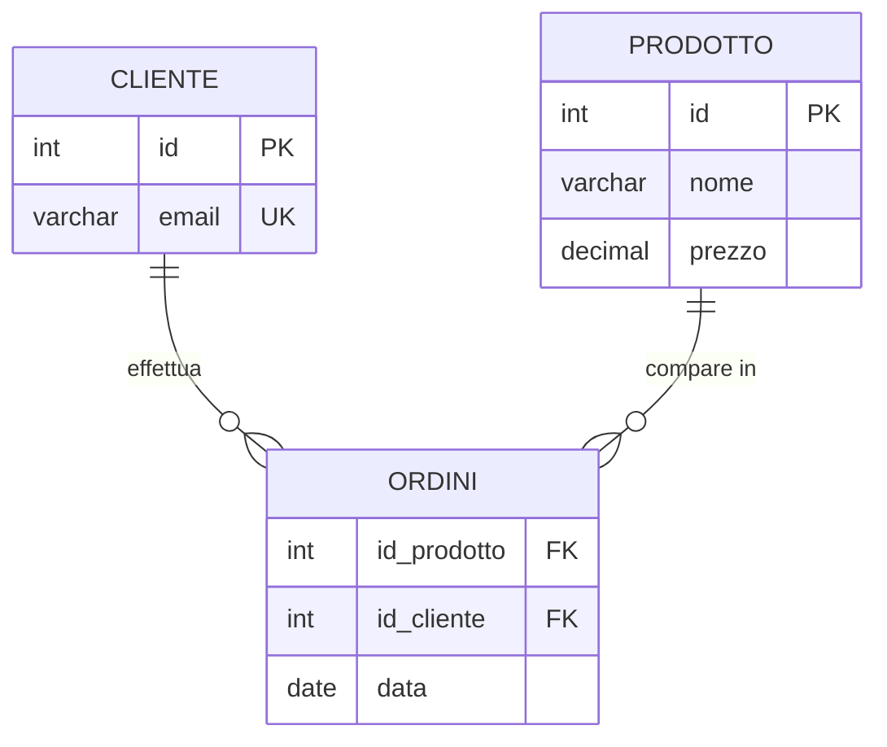

# Documentazione tecnica — Casafiore Shop: analisi dei dati di vendita

## 1. Obiettivo

Il team Marketing & CRM di Casafiore Shop vuole basare le scelte per le campagne dei prossimi mesi su dati storici di vendita. La consegna richiede un **unico file SQL**, con le query **ordinate per fase** e **commenti chiari** che spieghino cosa fa ogni query e cosa rappresenta il risultato, perché il file sarà letto anche da colleghi del marketing che non scrivono SQL tutti i giorni.

Le cinque attività richieste:

1. **Preparazione dei dati**: importare le tabelle e unirle in un dataset integrato (cliente, nome e prezzo del prodotto, data dell'ordine);
2. **Analisi dei clienti**: spesa totale per cliente, ordinati per spesa (programma fedeltà);
3. **Analisi dei prodotti**: fatturato per prodotto, per individuare i best-seller;
4. **Analisi temporale**: vendite per giorno della settimana, fatturato medio giornaliero e giorni con la media più alta (newsletter e promozioni);
5. **Analisi degli ordini**: numero di prodotti per ordine, media e distribuzione.

## 2. Schema del database

Database: `casafiore_shop`.



| Tabella | Colonne | Vincoli |
|---------|---------|---------|
| `prodotto` | `id`, `nome`, `prezzo` | `id` chiave primaria; `nome` e `prezzo` `NOT NULL`; `prezzo` è `DECIMAL(10,2)` |
| `cliente` | `id`, `email` | `id` chiave primaria; `email` `NOT NULL` e `UNIQUE` |
| `ordini` | `id_prodotto`, `id_cliente`, `data` | chiavi esterne verso `prodotto(id)` e `cliente(id)` |

Alcune scelte:

- **`DECIMAL` per i prezzi** (e non `FLOAT`): evita gli errori di arrotondamento sui calcoli di denaro.
- **Chiavi esterne** su `ordini`: garantiscono che non esista un ordine per un prodotto o un cliente inesistente.
- **`UNIQUE` sull'email**: due clienti non possono avere la stessa email.

Dati caricati: **10 prodotti**, **5 clienti**, **20 ordini** (dal 1° al 20 gennaio 2025).

## 3. Le query, fase per fase

### Fasi 1-3 — Preparazione del database

Creazione del database, delle tre tabelle e inserimento dei dati. Tre `SELECT * FROM ...` finali permettono di controllare che i dati siano stati caricati correttamente (10, 5 e 20 righe).

### Fase 4 — Dataset integrato

```sql
FROM ordini AS o
INNER JOIN cliente AS c  ON o.id_cliente  = c.id
INNER JOIN prodotto AS p ON o.id_prodotto = p.id
```

Collega ogni ordine al cliente (tramite `id_cliente`) e al prodotto (tramite `id_prodotto`). Il risultato è una riga per ordine con: ID e email del cliente, ID, nome e prezzo del prodotto, data dell'ordine, ordinate per data. Si ottengono **20 righe**, quante gli ordini: nessun ordine va perso nel collegamento. Questo dataset è la base di tutte le analisi successive.

### Fase 5 — Analisi dei clienti

Per ogni cliente: `COUNT(*)` conta gli acquisti, `SUM(p.prezzo)` somma i prezzi dei prodotti acquistati (arrotondata con `ROUND`), `ORDER BY spesa_totale DESC` mette in cima chi ha speso di più.

| Cliente | Acquisti | Spesa totale |
|---------|----------|--------------|
| mario.rossi@example.com | 5 | **3.899,95 €** |
| anna.bianchi@example.com | 4 | 2.199,96 € |
| giulia.ferri@example.com | 3 | 879,97 € |
| luigi.verdi@example.com | 4 | 499,96 € |
| carla.neri@example.com | 4 | 299,96 € |

Il cliente che ha speso di più è Mario Rossi, con circa metà del fatturato totale (7.779,80 €): è il primo candidato per il programma fedeltà.

### Fase 6 — Analisi dei prodotti

Per ogni prodotto: `COUNT(*)` indica quante volte è stato acquistato, `SUM(p.prezzo)` il fatturato (prezzo × vendite, perché ogni riga di `ordini` è una vendita), ordinato dal maggiore.

| Prodotto | Prezzo | Venduto | Fatturato |
|----------|--------|---------|-----------|
| **Laptop** | 1.099,99 € | 2 | **2.199,98 €** |
| Fotocamera DSLR | 799,99 € | 2 | 1.599,98 € |
| Smartphone | 699,99 € | 2 | 1.399,98 € |
| Tablet | 499,99 € | 2 | 999,98 € |
| Monitor 4K | 299,99 € | 2 | 599,98 € |
| Smartwatch | 199,99 € | 2 | 399,98 € |
| Stampante | 129,99 € | 2 | 259,98 € |
| Tastiera Meccanica | 89,99 € | 2 | 179,98 € |
| Auricolari Bluetooth | 49,99 € | 2 | 99,98 € |
| Mouse Wireless | 19,99 € | 2 | 39,98 € |

Il best-seller per fatturato è il **Laptop**. Attenzione: tutti i prodotti sono stati venduti esattamente 2 volte, quindi la classifica per fatturato coincide con quella per prezzo e non dice nulla sulla popolarità relativa dei prodotti.

### Fase 7 — Analisi temporale

**Fatturato giornaliero.** Raggruppa per data (e per nome del giorno, con `DAYNAME`) e somma i prezzi: 20 giornate, ciascuna con una sola transazione.

**Tabella temporanea `fatturato_giornaliero`.** Salva il fatturato di ogni data (`CREATE TEMPORARY TABLE ... AS SELECT`). Una tabella temporanea esiste solo nella sessione corrente e sparisce alla chiusura: serve a semplificare il lavoro senza riempire il database di tabelle permanenti.

**Fatturato medio per giorno della settimana.** Sulla tabella temporanea, `AVG(fatturato_del_giorno)` raggruppato per `DAYNAME(data_ordine)`, con `COUNT(*)` che indica quante date del dataset appartengono a ciascun giorno.

| Giorno | Giornate | Fatturato medio |
|--------|----------|-----------------|
| **Giovedì** (Thursday) | 3 | **663,32 €** |
| Domenica (Sunday) | 3 | 639,99 € |
| Martedì (Tuesday) | 2 | 399,99 € |
| Sabato (Saturday) | 3 | 399,99 € |
| Mercoledì (Wednesday) | 3 | 306,66 € |
| Venerdì (Friday) | 3 | 226,66 € |
| Lunedì (Monday) | 3 | 89,99 € |

I giorni con la media più alta sono giovedì e domenica, il più basso il lunedì. Con 2-3 giornate per giorno della settimana e una sola vendita al giorno, la media dipende dal prezzo del singolo prodotto venduto quel giorno (es. il Laptop venduto un giovedì): non è un andamento affidabile, ma mostra come impostare l'analisi su dati reali.

> I nomi dei giorni sono in inglese perché `DAYNAME` segue la lingua impostata in `lc_time_names` (di default `en_US`). Si può cambiare con `SET lc_time_names = 'it_IT';` prima della query.

### Fase 8 — Analisi degli ordini

**Tabella temporanea `prodotti_per_ordine`.** Ogni riga di `ordini` è considerata un ordine. `ROW_NUMBER() OVER (ORDER BY data, id_cliente, id_prodotto)` assegna a ciascuno un numero progressivo (`id_ordine`); il criterio di ordinamento rende la numerazione ripetibile. `numero_prodotti` vale `1`, perché ogni riga registra l'acquisto di un solo prodotto.

**Media** dei prodotti per ordine con `AVG(numero_prodotti)`: **1,00**.

**Distribuzione** con `GROUP BY numero_prodotti` e `COUNT(*)`:

| Prodotti nell'ordine | Numero di ordini |
|----------------------|------------------|
| 1 | 20 |

### Fase 9 — Conclusione

Riassume i risultati: il cliente che spende di più, il prodotto best-seller, l'andamento settimanale e l'analisi per ordine, e spiega che sono state usate tabelle temporanee per non riempire il database di tabelle permanenti.

## 4. Tecniche SQL utilizzate

| Tecnica | Dove |
|---------|------|
| DDL: `CREATE DATABASE`, `CREATE TABLE` con `PRIMARY KEY`, `FOREIGN KEY`, `UNIQUE`, `NOT NULL` | fasi 1-2 |
| `INSERT` con più righe | fase 3 |
| `INNER JOIN` con alias | fasi 4-8 |
| Funzioni di aggregazione `COUNT`, `SUM`, `AVG`, `ROUND` con `GROUP BY` | fasi 5-8 |
| `GROUP BY 1,2` (per posizione) e `ORDER BY` su alias | fasi 5-7 |
| Funzione di data `DAYNAME` | fase 7 |
| Tabelle temporanee `CREATE TEMPORARY TABLE ... AS SELECT` | fasi 7-8 |
| Funzione finestra `ROW_NUMBER() OVER (ORDER BY ...)` | fase 8 |

## 5. Organizzazione del file SQL

Il file è diviso in **fasi** con un commento a blocco per ciascuna, e ogni query è preceduta da un commento che spiega cosa calcola e come leggere il risultato, senza dare per scontata la conoscenza di SQL. Questo risponde al requisito della consegna: il file deve poter essere letto anche da chi lavora nel marketing.

## 6. Limiti noti

- **Dataset molto piccolo e fittizio.** 10 prodotti, 5 clienti, 20 ordini in 20 giorni: ogni giorno della settimana ha solo 2-3 date e una vendita al giorno, quindi le medie per giorno non sono statisticamente affidabili.
- **Tutti i prodotti venduti 2 volte.** La classifica per fatturato coincide con quella per prezzo: non si può distinguere un best-seller "per popolarità".
- **Nessun identificativo d'ordine né quantità.** La tabella `ordini` non ha un ID ordine, quindi più prodotti acquistati insieme non sono distinguibili da acquisti separati: ogni riga è trattata come un ordine con un solo prodotto, e la fase 8 restituisce sempre 1. Con un `id_ordine` e una `quantita` l'analisi diventerebbe significativa.
- **Nessuna chiave primaria su `ordini`.** Lo stesso cliente può acquistare lo stesso prodotto lo stesso giorno senza che le righe siano distinguibili.
- **Prezzo attuale.** Il fatturato usa il prezzo presente in `prodotto`: se i prezzi cambiassero nel tempo, il fatturato storico verrebbe falsato (servirebbe salvare il prezzo al momento dell'ordine).
- **Compatibilità.** Lo script usa `DAYNAME` e `CREATE TEMPORARY TABLE schema.tabella`, funzioni di MySQL, e `ROW_NUMBER`, che richiede MySQL 8.0+ (o MariaDB 10.2+). Su altri database servono adattamenti.
- **Tabelle temporanee.** Esistono solo nella sessione in cui sono create: se la connessione si chiude, le query delle fasi 7 e 8 che le usano vanno rieseguite dopo averle ricreate.
- **Idempotenza.** `CREATE DATABASE` dà errore se il database esiste già: per rieseguire lo script da zero bisogna prima eliminarlo (`DROP DATABASE casafiore_shop;`).

## 7. Sviluppi futuri

- **Aggiungere `id_ordine` e `quantita`** alla tabella `ordini` per un'analisi reale del numero di prodotti per ordine e del carrello medio.
- **Dati più ampi**, su più mesi, per analisi stagionali e per un'analisi per mese e settimana.
- **Segmentazione dei clienti** (RFM: recenza, frequenza, valore) per il programma fedeltà.
- **Percentuale di fatturato per cliente e per prodotto**, con funzioni finestra (`SUM() OVER ()`), e classifiche con `RANK()` / `DENSE_RANK()`.
- **Viste (`CREATE VIEW`)** per il dataset integrato, così da non ripetere i `JOIN` in ogni query.
- **Indici** sulle chiavi esterne se le tabelle crescono.
- **Dashboard** (Power BI, Tableau o Metabase) collegata al database per i colleghi del marketing.
